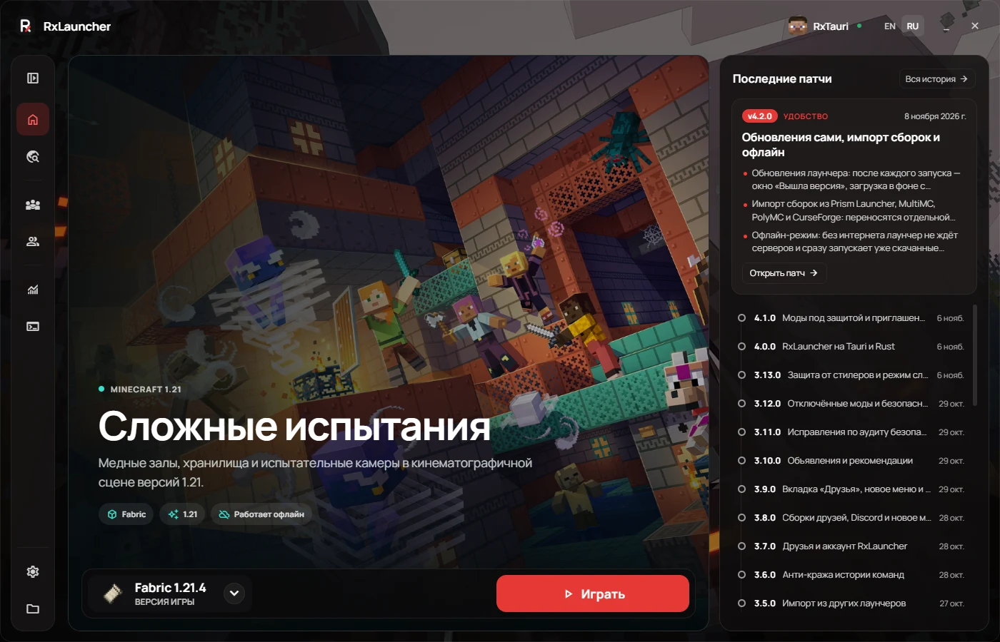
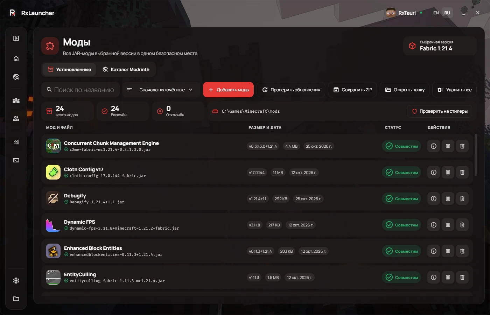
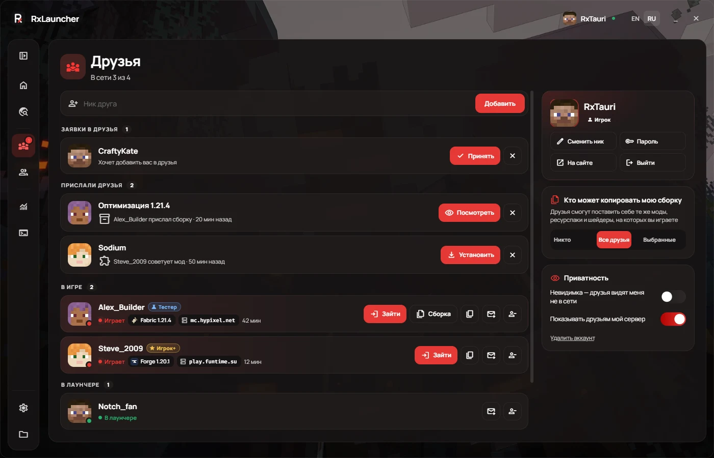
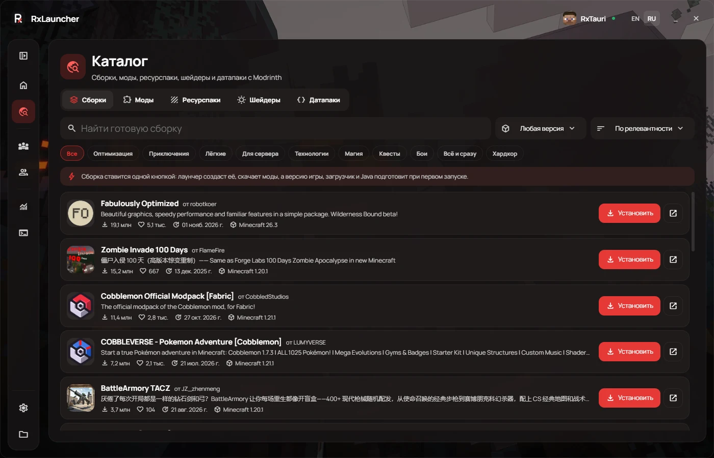
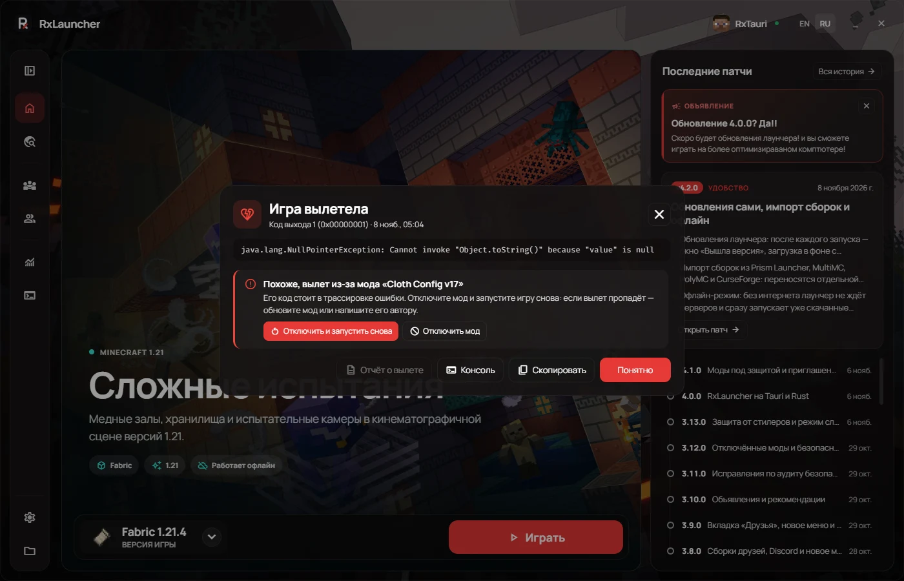

# RxLauncher

Бесплатный Minecraft-лаунчер с открытым исходным кодом. Любые версии игры, готовые сборки в один клик, моды без поиска по сайтам, проверка модов на стилеры и игра с друзьями.



## Скачать

- **[RxLauncher для Windows — последний релиз](https://github.com/ReflexerFTP/RxLauncher/releases/latest)** (установщик `RxLauncher Setup …exe`, ~53 МБ, Windows 10 и 11)
- [Сайт лаунчера](https://rxlauncher.xyz) · [Аккаунт и друзья](https://rxlauncher.xyz/account/)
- [Discord](https://discord.gg/eDF6cUmAfN) · [Telegram](https://t.me/rxlauncher)

Дальше лаунчер обновляется сам: показывает, что нового, качает обновление в фоне (с докачкой при обрывах) и ставит его после перезапуска. Каждое обновление подписано ключом RxLauncher — поддельное лаунчер не установит.

## Возможности

- **Любые версии Minecraft**: релизы, снапшоты, бета и альфа; Fabric, Forge, NeoForge, Quilt и Forge с OptiFine; свои версии.
- **Каталог Modrinth**: сборки, моды, ресурспаки, шейдеры и датапаки. Мод ставится вместе с зависимостями, сборка — целиком, одной кнопкой. Обновления модов проверяются сами.
- **Защита от стилеров**: моды проверяются ещё до установки и перед каждым запуском — Discord-вебхуки и боты, Telegram-боты, кража токенов, паролей и сессии. Файлы, совпадающие с Modrinth, отмечены значком «Проверено Modrinth».
- **Сборки**: отдельные игры со своими модами, мирами, настройками и памятью. Импорт из Prism Launcher, MultiMC, PolyMC, CurseForge, TLauncher и Legacy Launcher.
- **Друзья**: кто где играет, «Зайти к другу», «Позвать на сервер», отправить другу сборку или мод — даже если он не в сети.
- **Играть вместе**: код сборки и приглашение на сервер, экспорт в `.mrpack`.
- **Разбор вылетов**: причина простыми словами, виновный мод по трассировке ошибки и кнопка «Отключить и запустить снова».
- **Офлайн-режим**: без интернета запускается всё, что уже скачано.
- **Защита аккаунтов**: анти-кража истории команд (пароли `/login` не остаются в файлах игры), история входов в аккаунт RxLauncher на сайте.
- **Копии миров, статистика, скины, серверы, скриншоты, Discord Rich Presence** и широкие настройки оформления.

| | |
|---|---|
|  |  |
|  |  |

## Как устроен

RxLauncher 4 написан на [Tauri 2](https://tauri.app): ядро на **Rust** (запуск игры, загрузки, Java и загрузчики, архивы, проверка модов, шифрование данных), интерфейс — HTML/CSS/JS в системном WebView2. Поэтому установщик в несколько раз меньше, а лаунчер быстрее и легче, чем прежняя версия на Electron.

- `src-tauri/` — ядро на Rust
- `web/` — интерфейс
- `tauri/` — сборка интерфейса, прослойка API для интерфейса, подпись обновлений, красивый установщик
- `resources/installer/` — установщик и окно удаления (C#)

## Сборка из исходников

Нужны Node.js 22+ и Rust (stable) с Visual Studio Build Tools.

```bash
git clone -b tauri https://github.com/ReflexerFTP/RxLauncher.git
cd RxLauncher
npm install --prefix tauri/.deps ejs jquery mcnbt toml@npm:@iarna/toml @tauri-apps/cli@2
node tauri/build-ui.cjs
node tauri/.deps/node_modules/@tauri-apps/cli/tauri.js build
```

Проверки: `node tests/run.cjs` (интерфейс и модули) и `cargo test --manifest-path src-tauri/Cargo.toml` (ядро). Релизы собираются в GitHub Actions (`.github/workflows/tauri.yml`).

## Безопасность и приватность

- Токены аккаунтов шифруются средствами Windows (DPAPI + AES-GCM), история команд с паролями между сессиями хранится в зашифрованном хранилище.
- Сеть для модов и сборок — только HTTPS, без обращений к локальной сети; архивы проверяются на опасные пути и ссылки; файлы сверяются по хешам.
- Игровая статистика остаётся на вашем компьютере. Аккаунт RxLauncher (друзья) — по желанию.
- Нашли уязвимость — напишите в [Issues](https://github.com/ReflexerFTP/RxLauncher/issues) или в Discord.

## Лицензия

Проект распространяется под лицензией GPL-3.0. Подробности — в файле [LICENSE](LICENSE).

RxLauncher не является официальным продуктом Minecraft и не связан с Mojang или Microsoft.
